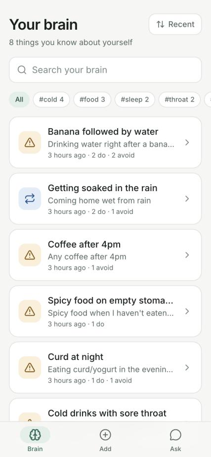
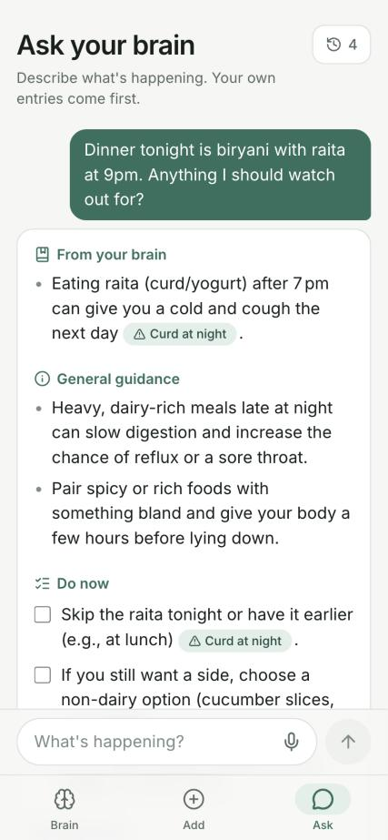
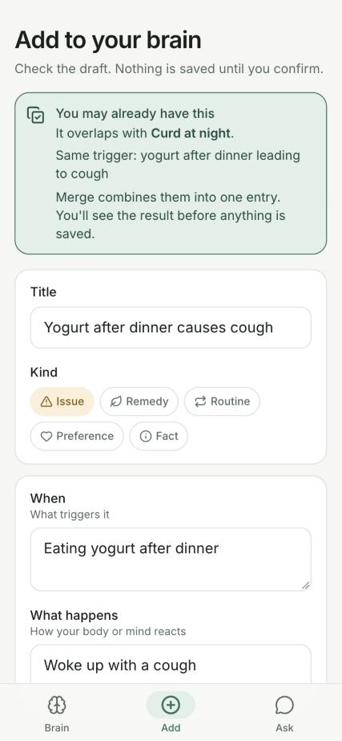

# Life Brain 🧠

[](https://github.com/VedPawar1410/life-brain/actions/workflows/ci.yml)

A **local-first "second brain" for what you learn about your own body and life.** Tell it
"curd at night gives me a cold and cough" once; weeks later ask *"dinner tonight is biryani with
raita at 9pm, anything to watch out for?"* and it answers from **your** notes first (raita is
curd), then general guidance, then a checklist.

**Not deployed, on purpose.** It holds personal health notes, so everyone runs their own copy on
their own machine; your data never leaves it except the question you send to the LLM. You can
use it from your phone privately over [Tailscale](#on-your-phone-installable-app--voice-via-tailscale).

| Metric (measured Nov 2026, see [`backend/reports/`](backend/reports)) | Result |
|---|---|
| Ask eval: cites your entries, emergency first, no invented citations | **9/9, 9/9, 8/9** over 3 runs (Groq `gpt-oss-120b`) |
| Capture eval: structure a note, flag duplicates, never invent advice | **6/6** (was 4/6 before the duplicate fix) |
| Ask latency (average / first word) | **1.6–2.2 s / 0.9–1.3 s** (Groq) |
| Cost per answer | **Free** on Groq · **$0.00047** on the optional Claude Haiku 5.5 fallback |
| Automated tests | **34** (LLM mocked, never spend money), run by CI on every PR and weekly |

> ⚠️ A personal notebook, not medical advice.

<p align="center">
  <picture>
    <source media="(prefers-color-scheme: dark)" srcset="docs/screenshots/brain-dark.jpg">
    
  </picture>
  <picture>
    <source media="(prefers-color-scheme: dark)" srcset="docs/screenshots/ask-dark.jpg">
    
  </picture>
  <picture>
    <source media="(prefers-color-scheme: dark)" srcset="docs/screenshots/capture-dark.jpg">
    
  </picture>
</p>
<p align="center"><sub>Demo brain (synthetic data), shown in your GitHub theme (light or dark). Left: your entries.
Middle: Ask infers raita is curd and cites <b>Curd at night</b>. Right: a new note is flagged as overlapping
an existing entry before anything is saved.</sub></p>

## How it works

```
 phone / browser ──HTTPS (Tailscale, optional)──┐
                                                ▼
                 Next.js 16  (127.0.0.1:3000)   UI + /api/* proxy
                                                │ server-side
                                                ▼
                 FastAPI     (127.0.0.1:8000) ──► Postgres (local)
                     │
                     ├─ Capture: note ──► LLM (strict JSON schema) ──► draft + possible duplicate
                     │                                                  (you review; nothing saved yet)
                     └─ Ask: question + ALL your entries ──► LLM ──► streamed answer citing [#id]
                                 │
                 provider chain: Groq gpt-oss-120b → gpt-oss-20b → Claude Haiku 5.5 (only if a key is set)
```

**Why these choices**
- **Send the whole brain on every question instead of retrieval (RAG).** A personal brain is small:
  ~350 tokens of instructions + ~60 per entry. The model never misses a relevant note and can
  connect notes that look unrelated (raita → curd). Retrieval lives behind one function,
  `select_entries()`, for when a brain outgrows Groq's free tier (about 110 entries at one
  question a minute).
- **You confirm every write.** Capture returns a draft; merging shows the combined entry for you to
  edit before saving, because merging can only add, and your body changes its mind.
- **Duplicate detection = LLM + a cheap rule.** The model flags overlaps; if it misses one, an entry
  sharing **2+ tags** is suggested. Measured: the model alone found as few as 1 of 3 real duplicates
  in one run.
- **Free first, paid only as a fallback.** Groq is faster (1.6–2.2 s vs 4.6 s) and free; Claude
  Haiku steps in only on rate limits or outages, before any text streams, so an answer never mixes
  models. A bad request never falls back (it would fail the same way, and cost money).
- **One origin, bound to localhost.** The browser only talks to Next.js, which proxies `/api` to
  FastAPI. Everything listens on `127.0.0.1`; phone access goes through Tailscale, never the LAN.
- **No login, no hosting.** Accounts, encryption at rest and multi-tenant storage of strangers'
  health notes would be a different, riskier product. Local-first sidesteps all of it.

## Data

- **Your brain:** your own local Postgres database (`life_brain`). Nothing is committed to git.
- **Demo / eval brain:** 8 synthetic entries in [`backend/evals/cases.py`](backend/evals/cases.py)
  (curd at night, rain, banana + water, coffee after 4pm, …). The eval and the demo seed use the
  same brain, so what you try by hand is what the eval measures.
- **Where your text goes:** each capture or question is sent to Groq (no retention of inference data
  by default, per their docs) and, only on fallback, to Anthropic. Gemini's free tier was considered
  and rejected: its pricing page says free-tier content is used to improve Google's products.

## Results

The eval ([`backend/evals/`](backend/evals)) runs 6 capture + 9 ask cases against the real model,
with no database writes. Each report records the commit, models, every answer and its checks.

| Run (`backend/reports/`) | Capture | Ask | Ask avg / first word | Notes |
|---|---|---|---|---|
| `eval-baseline.json` | 4/6 | 9/9 | 1.56 s / 0.93 s | Two false duplicate flags (mango → curd via tag `food`) |
| `eval-dup-fix.json` | **6/6** | 9/9 | 1.79 s / 1.16 s | Duplicate rule needs 2 shared tags |
| `eval-provider-chain-groq.json` | 6/6 | 8/9 | 2.23 s / 1.28 s | Hike question cited all 8 entries (prompt unchanged; variance) |
| `eval-claude-haiku.json` (Claude only) | 5/6 | 8/9 | 4.61 s / 2.18 s | Whole run cost **$0.0055** (18K in / 7.5K out tokens) |
| `eval-false-alarm-baseline.json` | 6/6 | 9/10 | | Adds a no-false-alarm check on 8 harmless questions and a 2nd emergency case |
| `eval-false-alarm-fix.json` | 6/6 | 9/10 | | Tightened emergency rule: 0/8 false alarms, 2/2 emergencies alerted |

**Before vs after the November 2026 revive**

| | Before (Oct 8 code, audited Nov 12) | After |
|---|---|---|
| `npm run build` | ❌ refused (`SecurityFatalError`) | ✅ passes |
| Known runtime vulnerabilities | 1 critical (two unauthenticated RCEs in Next 16.4.0) | **0** |
| Brain readable from the Wi-Fi | ✅ yes: `curl http://<lan-ip>:3000/api/entries` returned every entry | ❌ connection refused |
| Capture eval | 4/6 | **6/6** |
| LLM eval | none (quality judged by single manual tries) | 15-case harness + 4 committed reports |
| When Groq is rate-limited | error | falls back to Claude Haiku (if a key is set) |
| Tests | 25, run by hand | **34**, plus lint, build and audit in CI (weekly too) |

## Project structure

```
backend/
  app/
    main.py            FastAPI app: CORS, routers, creates tables on startup
    config.py          every setting (DB, models, providers, keys) from env / backend/.env
    db.py, models.py   SQLAlchemy engine; Entry and Ask tables (lists as Postgres arrays)
    schemas.py         Pydantic request/response models, tag normalisation
    llm.py             the only code that calls LLMs: prompts, provider chain, streaming
    seed.py            loads the demo brain into an empty database
    routers/           entries.py (CRUD, merge, preview) · capture.py · ask.py (NDJSON stream, history)
  evals/               cases.py (synthetic brain + cases) · run.py (runs them, writes a report)
  reports/             committed eval reports (JSON)
  tests/               pytest; LLMs faked, Claude key blanked so tests never spend money
frontend/
  app/                 pages: Brain (/), entry detail, Add (capture flow), Ask; icons + manifest
  components/          EntryForm, AddFlow, Markdown (tiny renderer for cited answers), MicButton, …
  lib/api.ts           every call to the backend, including the streamed Ask
  next.config.ts       /api proxy, Tailscale dev origins
docs/screenshots/      README images in light and dark (demo brain, production build)
.claude/launch.json    dev server configs used while building
```

## Run locally

Needs Postgres, [uv](https://docs.astral.sh/uv/), Node 20+ and **npm 11.19+** (older npm drops
optional WebAssembly entries from `package-lock.json`, and CI's `npm ci` then rejects it). A free Groq key from
[console.groq.com](https://console.groq.com).

```bash
createdb life_brain && createdb life_brain_test

cd backend
cp .env.example .env          # put your Groq key in LLM_API_KEY
uv sync
uv run uvicorn app.main:app --reload            # API on http://127.0.0.1:8000/docs

cd ../frontend
npm install
npm run dev                                     # http://localhost:3000, open at phone width
```

**Try it with the demo brain** without touching your own:

```bash
createdb life_brain_demo
cd backend
DATABASE_URL=postgresql+psycopg://localhost/life_brain_demo uv run python -m app.seed
DATABASE_URL=postgresql+psycopg://localhost/life_brain_demo uv run uvicorn app.main:app --reload
```

**Start your own brain from scratch** (deletes everything in it):

```bash
dropdb life_brain && createdb life_brain
```

**Test and evaluate.** CI ([`.github/workflows/ci.yml`](.github/workflows/ci.yml)) runs the tests against a
Postgres service, then lint, build and `npm audit` (fails on high/critical) on every PR, every push to
`main` and **weekly**, so dependency advisories surface even when nobody touches the code.

```bash
cd backend
uv run pytest                                   # 34 tests, free
uv run pytest -m live                           # real API smoke tests (Claude one costs < $0.001)
uv run python -m evals.run --out reports/eval-mine.json             # ~4 min, free on Groq
PROVIDERS='["claude"]' uv run python -m evals.run --pause 1 --out reports/eval-claude.json   # ~$0.006
```

### LLM settings (`backend/.env`)

| Variable | Default | Meaning |
|---|---|---|
| `LLM_API_KEY` | (empty) | Groq key. Any OpenAI-compatible API works via `LLM_BASE_URL` |
| `CAPTURE_MODEL` / `ASK_MODEL` / `FALLBACK_MODEL` | `gpt-oss-20b` / `gpt-oss-120b` / `gpt-oss-20b` | Groq models |
| `ANTHROPIC_API_KEY` | (empty) | Optional. Empty = Claude is never called, nothing is ever spent |
| `CLAUDE_MODEL` | `claude-haiku-5-5` | Paid fallback model |
| `PROVIDERS` | `["groq", "claude"]` | Order to try. `["groq"]` = free only |

Groq free tier (checked Nov 2026): **8K tokens/minute, 200K/day, 30 requests/minute** per model.
A capture is ~1.5K tokens; an answer ~1.4K with the demo brain.

### On your phone (installable app + voice) via Tailscale

Installing to the home screen and the microphone both require **HTTPS**. Tailscale gives your Mac a
private HTTPS address that only *your* devices can reach.

1. Install Tailscale on your Mac and phone, signed in to the same account.
2. In the Tailscale admin console → **DNS**, enable **MagicDNS** and **HTTPS certificates**.
3. With both servers running, on the Mac: `tailscale serve --bg 3000`. It prints
   `https://<your-mac>.<tailnet>.ts.net`; open that on your phone.
4. **iPhone:** Safari → Share → *Add to Home Screen*. **Android:** Chrome → ⋮ → *Install app*.

Stop sharing with `tailscale serve --https=443 off`. Only Next.js is shared; FastAPI and Postgres
stay on localhost. The dev and start scripts bind Next.js to `127.0.0.1` too: it proxies `/api`
to the backend, so Next's default (all interfaces) would expose your whole brain to the Wi-Fi.

Voice input (🎙️ on Add and Ask) uses the browser's Web Speech API; the button only appears where
it's supported (not Firefox) and on a secure page.

**Verified on an iPhone (Nov 2026) over Tailscale:** HTTPS loads in Safari and as an installed app;
the home-screen icon, full-screen launch, streamed answers with entry chips, and voice input all work,
**including voice inside the installed app** (iOS asks for microphone and speech-recognition access
the first time).

### API

| Method | Path | Notes |
|---|---|---|
| GET | `/entries?q=&tag=` | newest first; `q` = text search, `tag` = exact tag |
| POST · GET · PATCH · DELETE | `/entries`, `/entries/{id}` | PATCH changes only the fields you send |
| POST | `/entries/{id}/merge?preview=` | fold a draft into an entry; `preview=true` returns the result without saving |
| POST | `/capture` | `{text, ask_id?}` → structured draft + possible duplicate (nothing saved) |
| POST | `/ask` | `{question}` → NDJSON stream: `entries`, `meta` (model, provider), `delta`…, `done` + `saved`, or `error` |
| GET · DELETE | `/asks`, `/asks/{id}` | question/answer history |

## Deployment

None, by design: local-first. "Production" is the run commands above on your own machine, plus
Tailscale for your phone. Pinned: Next.js 16.4.6, Python ≥ 3.11 (deps locked in `uv.lock`, frontend
in `package-lock.json`).

## Limitations

- **Duplicate detection misses ingredient-level overlaps.** "Lassi after dinner gave me a cough"
  was *not* flagged against "Curd at night": the model didn't connect lassi to curd at capture time
  (it did connect raita to curd at ask time) and the draft shared only one tag. You can still merge
  by hand.
- **Emergency false alarms are reduced, not proven gone.** The model used to promote conditional
  warnings ("if you develop a fever…") to a red emergency alert on harmless questions (1 in 12
  repeated runs). The prompt now separates symptoms happening *now* from warning signs to watch for:
  0 in 12 after, with both real emergencies still alerted. Twelve runs can't prove a rare bug is gone.
- **Over-citation.** On a question unrelated to most entries (a hike), answers sometimes cite
  entries that don't apply (all 8 in one Groq run).
- **The eval is a smoke test, not a benchmark.** 15 cases, one run each; results vary between runs
  (the LLM alone found 2 of 3 real duplicates in one run, 1 of 3 in another). The hike and phone-scrolling
  cases also involve judgment calls.
- **Groq → Claude hand-off is verified with mocked tests only;** each provider was tested live on its
  own, but a real Groq 429 couldn't be forced.
- **Phone install and voice are verified on one iPhone only** (Safari and the installed app, Nov 2026);
  Android is untested.
- **Scale:** sending the whole brain hits Groq's free-tier limit at ~110 entries per question-minute.
- **7 moderate advisories remain in dev-only linter dependencies** (`minimatch` inside
  `eslint-config-next`); they never ship.
- **Single user, no auth,** by design. Don't expose it beyond localhost/Tailscale.

## Learning log: mistakes and what I learned

I built this in layers; each records what went wrong and the lesson.

### Layer 1 - The build (8 Oct 2026, Claude Code, Groq gpt-oss, FastAPI, Next.js 16)

*What I built:* a FastAPI + Postgres + Next.js app in 7 PRs in one day: CRUD, AI capture with
duplicate detection, streamed Ask, history with "save what worked", merge preview, and an
installable PWA with voice input.

| # | Mistake | What actually happened | Lesson |
|---|---|---|---|
| 1.1 | **Tuned a heuristic on 2 data points** | The "1 shared tag = duplicate" backstop worked on a 2-entry brain. With 8 entries, "Mangoes give me pimples" was flagged as "Curd at night" via the tag `food` (capture eval 4/6). | Validate rules on data the size of real use, not the size of the demo. |
| 1.2 | **A proxy exposed the backend** | I bound FastAPI to localhost, then added a Next.js `/api` proxy. `next dev` listens on all interfaces, so `curl http://<lan-ip>:3000/api/entries` returned every entry to anyone on the Wi-Fi. | A proxy inherits the exposure of whatever is in front of it. Check what's reachable, not what you intended. |
| 1.3 | **Dependencies rot while you're away** | The app built fine on Oct 8. By Nov 12, Next 16.4.0 had two unauthenticated RCE advisories and `next build` refused to run. | Pin, audit and build on a schedule (CI), not only when you touch the code. |
| 1.4 | **Pasted an API key into a chat** | I sent my Groq key in the AI chat so it could be added to `.env`. It never reached git, but it's now in a transcript. | Never paste secrets anywhere. Edit `.env` yourself and rotate anything that was exposed. |
| 1.5 | **Merge could only add** | After I reported "ginger tea didn't help", the merged entry still said "Warm ginger tea" under Do. | When data can contradict itself, show the result and let a human edit before saving (fixed with merge preview, PR #6). |
| 1.6 | **Tested against my real database** | Browser tests merged demo notes into my seed entries and left test questions in my history. | Use a separate demo/test database for anything that writes. |
| 1.7 | **Judged LLM quality by a few manual tries** | "3/3 correct" on one run of a handful of notes. The same check across runs found the model alone catching 2 of 3 real duplicates once and 1 of 3 another time. | Build a small fixed eval early and expect run-to-run variance. |
| 1.8 | **Guessed instead of measuring** | I predicted Ask would hit the rate limit "at a few dozen entries". Measured cost (~350 + 60 tokens per entry) puts it at ~110. | Measure before predicting, especially costs and limits. |
| 1.9 | **Returned a value from `useEffect`** | `useEffect(() => ref.current?.scrollIntoView(...))` returned a Promise in newer Chrome, which React rejects as a cleanup function. Caught only in the browser. | Effects return nothing or a cleanup; test in a real browser, not just the type checker. |
| 1.10 | **Never opened the installed app on a real phone** | On an iPhone the installed app's titles sat under the status bar (blurred) and the bottom nav floated up on short pages, covering the Ask input. Desktop browsers and Safari tabs report zero safe-area insets, so none of it showed up in testing. | Test a PWA as an installed app on a real device; emulators don't reproduce safe areas. |

### Layer 2 - The rebuild (Nov 2026)

*What I did:* audited the month-old code from a clean clone, measured a baseline with a new eval
harness, then fixed one thing per PR, with numbers before and after each.

| # | Decision | Why |
|---|---|---|
| 2.1 | Next.js 16.4.6, servers bound to `127.0.0.1` (first PR, smallest diff) | Fix the broken build, the RCEs and the Wi-Fi exposure before anything else (1.2, 1.3) |
| 2.2 | Committed eval harness + baseline before any fix | Every later change gets a before/after number (1.7) |
| 2.3 | Ambiguous eval label decided *before* the fix | Changing labels after seeing results is tuning to the test set |
| 2.4 | Duplicate backstop needs 2 shared tags; kept, not removed | Removed both false flags (4/6 → 6/6) while still catching the duplicate the LLM missed (1.1) |
| 2.5 | Groq first, Claude Haiku 5.5 as a paid fallback; tests blank the key | Free and faster by default; ~$0.0005 per answer only when Groq is down; tests can't spend money |
| 2.6 | Local-first, open source, no hosting | Strangers' health notes shouldn't live on my server; a demo brain + screenshots show it instead |
| 2.7 | Demo brain in its own database | Screenshots and demos never touch real data (1.6) |
| 2.8 | Rejected Gemini's free tier | Its free tier uses content to improve Google's products, which defeats local-first |
| 2.9 | CI on every PR plus a **weekly** run, with an `npm audit` gate; tests use a separate `TEST_DATABASE_URL` | The Oct 8 lockfile fails this gate (1 critical), so a weekly run would have caught 1.3 within days. Tests drop every table, so they never trust `DATABASE_URL`. The first real run still failed twice where my local simulation passed: `setup-uv` has no floating `v10` tag, and the runner's newer npm (11.19) rejected a lockfile written by npm 11.6. Simulating CI isn't running CI |
| 2.10 | Pad by `env(safe-area-inset-*)`; `<body>` uses `min-h-lvh` instead of `h-full`/`min-h-full` | Fixes 1.10. In the installed app "100%" height excludes the status bar, so on short pages iOS anchored the fixed nav to a shorter page. Found only by testing on the phone. (Also learned: running `npm ci` under a live dev server corrupts Turbopack's cache; stop the server first.) |
| 2.11 | No-false-alarm check on every harmless eval question; emergency rule limited to symptoms happening now | The redesign turned the emergency line into a red alert, which made false alarms worse. Measured with 12 repeated runs (1 → 0 false alarms) while keeping 2/2 real emergencies alerted |

*Known gaps I chose not to fix (yet):* ingredient-level duplicates (lassi → curd), rare emergency
false alarms (reduced, not proven gone), over-citation on unrelated questions, Android testing, and dev-only linter
advisories.

### Layer 3 - The redesign (Nov 2026)

*What I did:* replaced the prototype UI in five PRs with a "calm clinical" design (light and dark,
Inter, Lucide icons), and fixed the prompt problem the new design made more visible.

| # | Decision | Why |
|---|---|---|
| 3.1 | All colours as tokens in one CSS file; a script checks 17 text/background pairs in both modes (WCAG AA) in CI | It caught the placeholder grey at 2.95:1 on the first run |
| 3.2 | Audit where each colour is *used*, not just the pairs | Small labels used the icon grey (3.48:1 is fine for icons, too low for 12px text). The script checks pairs, so it missed this |
| 3.3 | One icon set (Lucide) and one kind system (colour + icon per entry kind), used everywhere | Twelve emojis looked cheap; a single kind map keeps list tiles, badges, the picker and citation chips consistent |
| 3.4 | Verify lockfile changes with CI's npm version, and require npm 11.19+ | My Mac's npm 11.6 dropped optional `@emnapi/*` entries twice; both times CI failed on a lockfile my local check had passed |
| 3.5 | Textareas sized to their content | The merge preview clipped merged text, at exactly the step where you need to see everything to delete stale advice |
| 3.6 | Catch clipboard refusals ("Couldn't copy") | A scripted test hit an uncaught `NotAllowedError`; real users can hit it too (permissions, older browsers) |
| 3.7 | Fix the false emergency alarm in the prompt, not the UI | Styling the emergency line as a red alert made a model mistake more alarming (decision 2.11 has the numbers) |
| 3.8 | Screenshots from a production build, light and dark via `<picture>` | No dev-mode badge, and GitHub shows each reader their own theme |

### Key takeaways

1. **Measure before you fix.** A 15-case eval turned "it seems fine" into 4/6 → 6/6 and exposed two
   new problems I hadn't noticed.
2. **Security regressions hide in glue code.** The proxy, not the API, leaked the data.
3. **Code you don't touch still breaks.** Dependencies age; a scheduled CI run with an audit gate catches it.
4. **Local-first is a product decision, not just a deployment one.** It removed auth, hosting and
   data-protection work entirely.
5. **A redesign is also a test.** Rebuilding every screen surfaced bugs the old UI hid: clipped text,
   unhandled clipboard errors, and a model failure that only looked serious once it was red.

## Future improvements

1. Eval cases for ingredient-level duplicates (lassi, raita, paneer → curd), then a prompt fix
   measured against them.
2. "Only cite entries that genuinely apply" in the Ask prompt, measured on the hike case.
3. `select_entries()` retrieval (tags/keywords first, then pgvector) once a brain passes ~100 entries.
4. A packaged setup (Docker Compose or SQLite) so non-developers can run it.

## License

[MIT](LICENSE)
